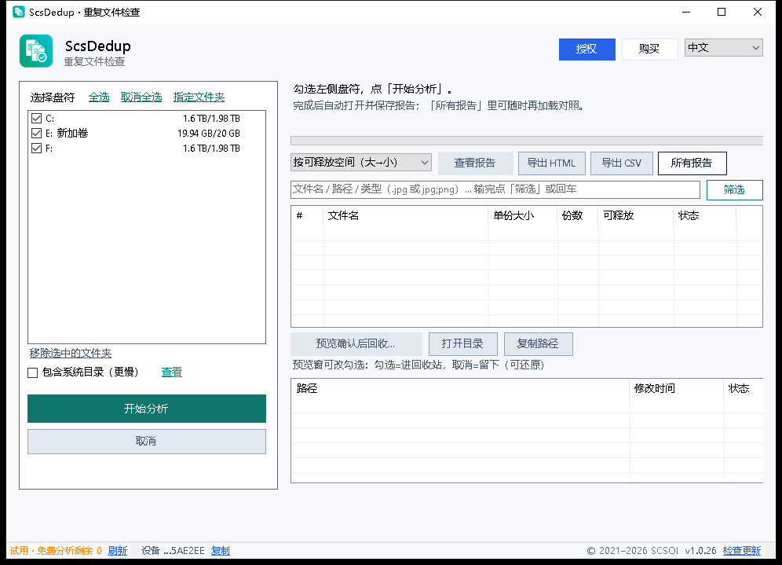

**English** · [中文](README.zh-CN.md)

> **ScsDedup is not ScsDrive.** ScsDriver was the old name of ScsDrive (https://drive.scsoi.com) — that is the WebDAV/NAS mounting tool, a different product. ScsDedup finds **true content duplicates** on Windows and shows reclaimable space. Official site: <https://dedup.scsoi.com>

  

<h1 align="center">ScsDedup</h1>

  <strong>Find duplicate files and reclaim disk space</strong> 
  Scan selected drives or folders, group true duplicates by content hash, and export a clear reclaim report — no silent deletes. 
  Official site: <a href="https://dedup.scsoi.com">https://dedup.scsoi.com</a>

  
  
  
  

  <a href="https://dedup.scsoi.com/#download"><strong>Download</strong></a> ·
  <a href="https://dedup.scsoi.com/#pricing"><strong>Pricing</strong></a> ·
  <a href="https://dedup.scsoi.com/faq"><strong>FAQ</strong></a> ·
  <a href="https://github.com/shuyingegit/scsdedup/releases"><strong>Releases</strong></a> ·
  <a href="https://drive.scsoi.com"><strong>ScsDrive</strong></a> ·
  <a href="https://subst.scsoi.com"><strong>ScsSubst</strong></a> ·
  <a href="https://expand.scsoi.com"><strong>ScsExpand</strong></a>

---

## Why ScsDedup?

Duplicate photos, downloads and copies quietly eat disk space. ScsDedup is a lightweight Windows tool that finds **true content duplicates** (even when names differ), sorts groups by reclaimable space, and opens a clear HTML report — **you** decide what to keep.

  

## Key Features

Simple, stable, report-first.

- **Multi-drive & folder scan** — Tick drives or add specific folders; cancel anytime with trustworthy progress.
- **Content hash, not file name** — Size buckets → sample → full SHA-256. Renamed or moved copies still group together.
- **Report first** — Beautiful HTML report with reclaimable space and paths; nothing is deleted automatically.
- **Preview before reclaim** — Confirm what goes to the Recycle Bin; keep vs reclaim colors are clear.
- **Filter & sort** — Filter by name / path / type (e.g. `.jpg;png`); sort by reclaimable space.
- **Export** — HTML / CSV; open folders or copy paths.
- **8 languages** — Chinese / English / Japanese / Korean / Spanish / French / German / Russian.
- **Small & ad-free** — Installer ~2.6 MB; no ads.
- **1 free full report + buyout** — One complete analysis free on this PC; buyout unlocks unlimited scans and updates.

## Pricing

| | China | Overseas |
|---|---|---|
| **Buyout** | **¥9.9** | **$1.99** |
| **Trial** | 1 free complete analysis report on this PC | same |

Buying once includes email support and ongoing feature updates.

## Download

Latest builds: **[GitHub Releases](https://github.com/shuyingegit/scsdedup/releases/latest)** · [Website](https://dedup.scsoi.com/#download)

| Package | Use when |
|--------|----------|
| **Portable (`.zip`)** | Unzip and run — recommended |
| **Installer (`.exe`)** | Classic setup |

CDN (same files):

- https://dl.scsoi.com/releases/scsdedup-latest-portable-win64.zip
- https://dl.scsoi.com/releases/scsdedup-latest-setup-win64.exe

## What this repository is

Public GitHub for **ScsDedup** hosts **Release installers only** (plus this README). Product source is maintained privately — same policy as ScsDrive / ScsSubst / ScsExpand.

## Sister products

- [ScsDrive](https://drive.scsoi.com) — Mount WebDAV / NAS as a local drive  
- [ScsSubst](https://subst.scsoi.com) — Map local folders to drive letters  
- [ScsExpand](https://expand.scsoi.com) — Expand a volume without wiping data  

## Support

Email: [support@scsoi.com](mailto:support@scsoi.com)

---

© SCSOI · [dedup.scsoi.com](https://dedup.scsoi.com)
