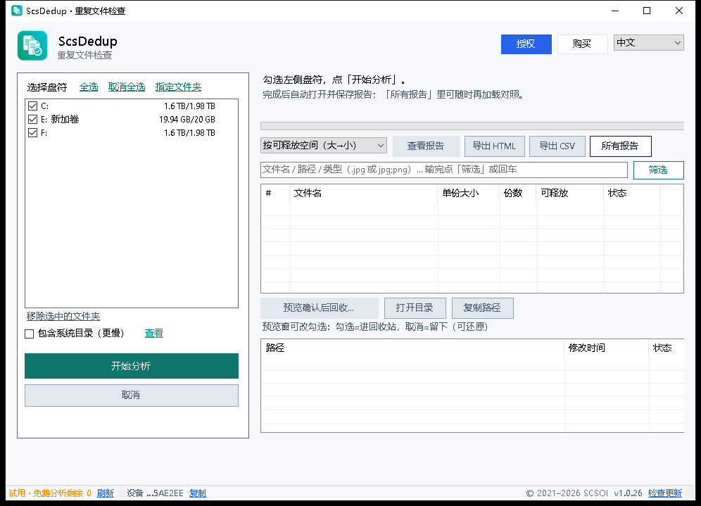

[English](README.md) · **中文**

> **ScsDedup 不是 ScsDrive。** ScsDriver 是 ScsDrive 的旧名（https://drive.scsoi.com）——那是 WebDAV / NAS 挂载工具，另一款产品。ScsDedup 在 Windows 上按**文件内容**找真重复，并标出可回收空间。官网：<https://dedup.scsoi.com>

  

<h1 align="center">ScsDedup</h1>

  <strong>找出重复文件，回收磁盘空间</strong> 
  勾选盘符或指定文件夹，按内容哈希归组真重复，导出清晰的可回收报告——不会偷偷删文件。 
  官网：<a href="https://dedup.scsoi.com">https://dedup.scsoi.com</a>

  
  
  
  

  <a href="https://dedup.scsoi.com/#download"><strong>下载</strong></a> ·
  <a href="https://dedup.scsoi.com/#pricing"><strong>定价</strong></a> ·
  <a href="https://dedup.scsoi.com/faq"><strong>常见问题</strong></a> ·
  <a href="https://github.com/shuyingegit/scsdedup/releases"><strong>Releases</strong></a> ·
  <a href="https://drive.scsoi.com"><strong>ScsDrive</strong></a> ·
  <a href="https://subst.scsoi.com"><strong>ScsSubst</strong></a> ·
  <a href="https://expand.scsoi.com"><strong>ScsExpand</strong></a>

---

## 为什么用 ScsDedup？

重复的照片、下载和拷贝会悄悄吃掉磁盘。ScsDedup 是轻量 Windows 工具：按**内容**找真重复（文件名不同也能检出），按可回收空间排序，并打开清晰的 HTML 报告——删不删由你决定。

  

## 核心功能

简单、稳定、报告优先。

- **多盘 / 指定文件夹** — 勾选盘符或加目录；可随时取消，进度可信。
- **内容哈希，不看文件名** — 大小分桶 → 采样 → 全量 SHA-256；改名、换路径仍归一组。
- **报告优先** — 精美 HTML 报告展示可回收空间与路径；不自动删文件。
- **预览后再回收** — 确认进回收站的项；保留 / 可回收配色分明。
- **筛选与排序** — 按文件名 / 路径 / 类型（如 `.jpg;png`）筛选；按可释放空间排序。
- **导出** — HTML / CSV；打开目录或复制路径。
- **内置 8 国语言** — 中 / 英 / 日 / 韩 / 西 / 法 / 德 / 俄。
- **体积小、无广告** — 安装包约 2.6 MB。
- **免费 1 次完整报告 + 买断** — 本机免费完整分析 1 次；买断后不限次，含更新。

## 定价

| | 国内 | 海外 |
|---|---|---|
| **买断** | **¥9.9** | **$1.99** |
| **试用** | 本机 1 次完整分析报告 | 同左 |

买断含邮件技术支持与持续功能更新。

## 下载

最新包：**[GitHub Releases](https://github.com/shuyingegit/scsdedup/releases/latest)** · [官网](https://dedup.scsoi.com/#download)

| 包 | 适用 |
|--------|----------|
| **绿色版（`.zip`）** | 解压即用（推荐） |
| **安装版（`.exe`）** | 传统安装 |

CDN（同文件）：

- https://dl.scsoi.com/releases/scsdedup-latest-portable-win64.zip
- https://dl.scsoi.com/releases/scsdedup-latest-setup-win64.exe

## 本仓库是什么

公开 GitHub **只挂 Release 安装包**（以及本 README），与 ScsDrive / ScsSubst / ScsExpand 相同策略；产品源码在私有仓维护。

## 姊妹产品

- [ScsDrive](https://drive.scsoi.com) — WebDAV / NAS 挂成本地盘  
- [ScsSubst](https://subst.scsoi.com) — 本地文件夹映射盘符  
- [ScsExpand](https://expand.scsoi.com) — 不丢数据扩容分区  

## 支持

邮箱：[support@scsoi.com](mailto:support@scsoi.com)

---

© SCSOI · [dedup.scsoi.com](https://dedup.scsoi.com)
